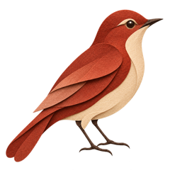
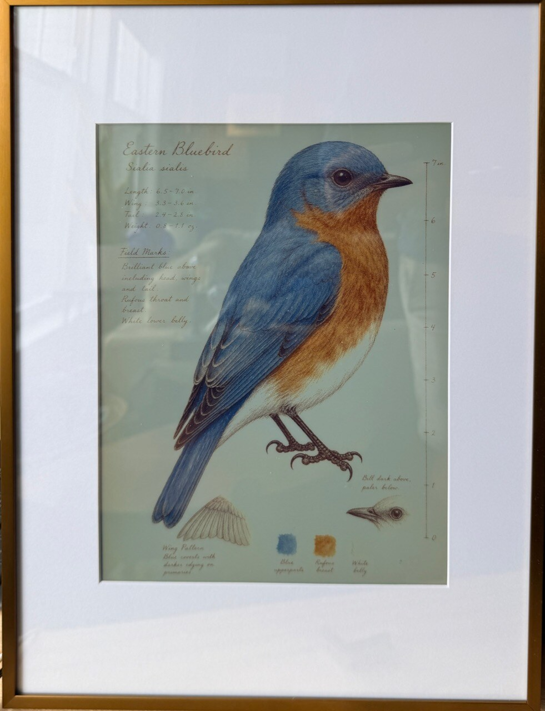
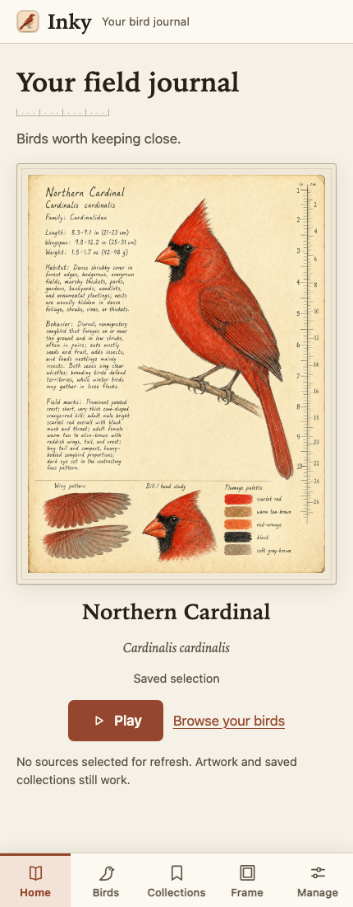
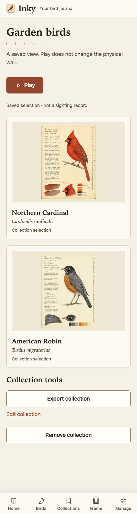

# Inky Bird 

*A field journal for the birds in your life.*

The cardinal at your feeder deserves a page.

Inky brings public sightings near you, station detections, imported birding
history and favorite species into a private illustrated journal. Read it on
your phone, save a collection, or put an approved plate on a color e-paper frame.
I built Inky to keep birding present between outings.

[**Browse the bird gallery**](https://henrysowell.com/birds) ·
[Supported sources](#supported-sources) ·
[Start without a frame](docs/settings.md#start-with-approved-art) ·
[Build a wall frame](docs/hardware.md)

  
   <em>Eastern Bluebird on the 13.3-inch e-paper build. The frame is optional.</em>

<table align="center">
  <tr>
    <td width="50%" align="center" valign="top">
      
       <strong>Open your journal</strong>
    </td>
    <td width="50%" align="center" valign="top">
      
       <strong>Keep a collection</strong>
    </td>
  </tr>
</table>

Both screenshots are from the app on `main`, with public approved artwork and
a sample collection. Open either image for the full-size view.

https://github.com/user-attachments/assets/a20b7917-ed88-4872-b2d9-39086501b73f

[Watch the 28-second walkthrough](https://github.com/user-attachments/assets/a20b7917-ed88-4872-b2d9-39086501b73f)
· [Text transcript](docs/walkthrough.md) · [Still preview](docs/images/inky-walkthrough-poster.jpg).
Sample data, accelerated navigation, and a separate e-paper installation;
browser Play does not refresh the wall.

## Supported sources

Bring nearby sightings, feeder visits, station detections and years of personal
birding history into one journal. Use one source or combine several.

| Source | What you can bring into Inky |
| --- | --- |
| [iNaturalist](docs/discovery.md#nearby-inaturalist-and-ebird-setup) | Nearby public bird observations around your location; no provider account. |
| [eBird](docs/discovery.md#nearby-inaturalist-and-ebird-setup) | Recent public sightings around your location; personal API key. |
| [eBird Archive](docs/discovery.md#ebird-personal-archive) | Your own checklists, trips and life list from an export; not continuous account sync. |
| [BirdWeather](docs/discovery.md#birdweather-station-setup) | Your station's acoustic detections; station token. |
| [BirdNET-Go](docs/discovery.md#self-hosted-birdnet-go-setup) | Your self-hosted station's detections over its read-only API. |
| [BirdNET Analyzer](docs/discovery.md#birdnet-analyzer-csv-import) | Recorded-audio detections from a CSV import. |
| [Bird Buddy](docs/discovery.md#bird-buddy-setup) | Feeder postcard species and optional manual sightings; account plus permission to use its private API. |

Inky reads detections; it does not record sound or run the detector. Public
nearby observations are not a claim that you personally saw a bird. Your imported
history and collections are not published with the reusable artwork catalog.

No source is required to browse approved art, save collections or play plates.
[Compare setup options and limits](docs/discovery.md).

## Start with what you have

| I want to… | Start here |
| --- | --- |
| See the artwork, with nothing to install | [Browse the public gallery](https://henrysowell.com/birds). |
| Keep a journal on a phone, tablet, or computer | Run the controller on an existing machine: [Docker or NAS](docs/docker.md) or [native installation](docs/installation.md). Open `/app` and [create your owner account](docs/browser-access.md). |
| Put birds on a wall | Use a browser in [Frame mode](docs/presentation.md#owner-frame), [pair a read-only screen](docs/presentation.md#pair-a-read-only-screen), or build the [7.3-inch or 13.3-inch e-paper frame](docs/hardware.md). |
| Connect a station, feeder, or observation account | [Choose a source](docs/discovery.md). Start with one, or keep using saved collections without any sources. |
| Upgrade an existing installation | [Back up your controller](docs/backup.md), read the notes for the [target release](https://github.com/veteranbv/inky-bird/releases), and follow its update guide. |

Browse, save collections, and play plates in the browser. With approved
artwork, you need no camera, microphone, provider account, or Codex login.
New app-managed setups start with generation off.

These docs describe `main`, which may be ahead of your install. If you run a
[tagged release](https://github.com/veteranbv/inky-bird/releases), follow
the instructions shipped with it.

## One plate, several ways to see it

When a species has an approved plate, your screens reuse it. Save birds to
Favorites or a named collection, then choose **Play** to see the full plates
without changing the physical wall. The optional e-paper display
downloads only approved assets and keeps the last picture if the network goes
down. Home Assistant and Homepage can show selected art on your trusted
network and use a separate credential for status. See
[screens and dashboards](docs/presentation.md).

The shared plates are AI-generated illustrations checked against references
and reviewed separately before approval. You can reuse the public catalog
under the [MIT license](LICENSE). If a species is missing, you can
[request it](https://github.com/veteranbv/inky-bird/issues/new?template=bird_request.yml)
or configure your own controller to generate it with Codex. Generation can
use a subscription allowance or incur API costs. See the
[review process](docs/architecture.md) and [owner controls](docs/owner-operations.md).

Your sightings and selections stay separate from the shared catalog. See
[what stays private and what leaves the controller](docs/privacy.md). Keep
the controller on a trusted network: owner sign-in does not protect the legacy
catalog and display routes. Do not port-forward the controller to the internet.
For private remote access, see the [access guide](docs/browser-access.md).

## Other bird projects

If you want a microphone-to-collage build, Teddy Warner’s
[AvianVisitors](https://github.com/Twarner491/AvianVisitors) is a good place to
start. [Fugleramme](https://github.com/arnegiacomo/fugleramme) and
[Featherframe](https://github.com/wr/featherframe) pair station detections
with historical natural-history illustrations. Inky is for keeping and
revisiting birds from several sources, including trips and manual selections,
as individual field-journal plates. You can start with the artwork alone.

## Docs and contributions

- [Documentation index](docs/README.md)
- [Troubleshooting](docs/troubleshooting.md)
- [Contribute code, docs, or a plate](CONTRIBUTING.md)
- [Report a bug](https://github.com/veteranbv/inky-bird/issues/new?template=bug_report.yml)
  or [flag a published plate problem](https://github.com/veteranbv/inky-bird/issues/new?template=plate_problem.yml)
- [Report a security issue privately](SECURITY.md)

Made by [Henry Sowell](https://henrysowell.com). Thanks to
[@dwalters0](https://github.com/dwalters0) for helping close the
[trusted browser-client gap](https://github.com/veteranbv/inky-bird/pull/246),
and to everyone who has shared a bird, a bug, or a fix.
