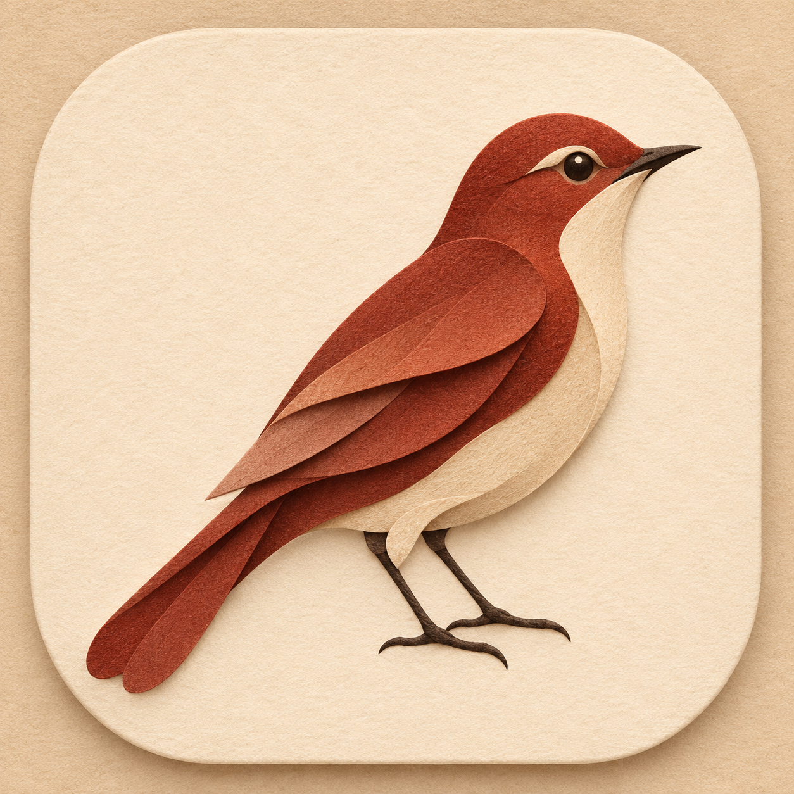

# Inky Bird

  

A private field journal for the birds you see, hear, and remember. Browse
illustrated plates on your phone, keep a collection from a favorite trip, or
let the birds take turns on an optional color e-paper frame.

[Browse the public gallery](https://henrysowell.com/birds) ·
[Start without a frame](docs/settings.md#start-with-approved-art) ·
[Build a wall frame](docs/hardware.md)

<table>
  <tr>
    <td width="50%" align="center" valign="top">
      
       <strong>Open your journal</strong>
    </td>
    <td width="50%" align="center" valign="top">
      
       <strong>Keep a collection</strong>
    </td>
  </tr>
</table>

Screenshots show the app on `main` using public approved artwork and manual
demo selections. Open either image for the full-size view.

## Start with what you have

| I want to… | Start here |
| --- | --- |
| See the artwork, with nothing to install | [Browse the public gallery](https://henrysowell.com/birds). |
| Keep a journal on a phone, tablet, or computer | Run the controller on an existing machine: [Docker or NAS](docs/docker.md) or [native installation](docs/installation.md). Open `/app` and [create your owner account](docs/browser-access.md). |
| Put birds on a wall | Use a browser in [Frame mode](docs/presentation.md#owner-frame), [pair a read-only screen](docs/presentation.md#pair-a-read-only-screen), or build the [7.3-inch or 13.3-inch e-paper frame](docs/hardware.md). |
| Connect a station, feeder, or observation account | [Choose a source](docs/discovery.md). Start with one, or keep using saved collections without any sources. |
| Upgrade an existing installation | [Back up your controller](docs/backup.md), read the notes for the [target release](https://github.com/veteranbv/inky-bird-frame/releases), and follow its update guide. |

Install the controller with Docker or from the terminal. Day-to-day
browsing, collections, and playback happen in the browser. With approved
artwork, you need no camera, microphone, provider account, or Codex login.
Generation is off in a new configuration until you choose to enable it.

These docs describe `main`. For an existing installation, use the instructions
shipped with your [tagged release](https://github.com/veteranbv/inky-bird-frame/releases)
rather than assuming the features shown here are already available to you.

## Bring your own birds

- **Nearby sightings:** use iNaturalist or eBird public observations.
- **A trip or life list:** import your own eBird archive and turn selected
  checklists into a private collection. This is an import, not continuous
  personal eBird sync.
- **Birds your station heard:** connect BirdWeather or BirdNET-Go, or import
  BirdNET Analyzer results. Inky reads detections; it does not record sound or
  run the detector.
- **Feeder visits:** connect Bird Buddy if you have permission to use its
  private API. You can also save a bird from the artwork catalog without
  recording a sighting.

[Compare source options and their limits](docs/discovery.md).

## One plate, several ways to see it

The controller reuses approved art for a species when it has a match. Save
birds in Favorites or a named collection, then choose **Play** to see the
full plates without changing the physical wall. The optional e-paper display
downloads only approved assets and keeps the last picture if the network goes
down. Home Assistant and Homepage can show selected art on your trusted
network and use a separate credential for status. See
[screens and dashboards](docs/presentation.md).

  
   <em>Eastern Bluebird on the 13.3-inch portrait build.</em>

The shared plates are AI-generated illustrations checked against references
and reviewed separately before approval. If a species is missing, you can
[request it](https://github.com/veteranbv/inky-bird-frame/issues/new?template=bird_request.yml)
or configure your own controller to generate it with Codex. Generation can
use a subscription allowance or incur API costs. See the
[review process](docs/architecture.md) and [owner controls](docs/owner-operations.md).

Your private sightings and selections stay separate from the reusable
catalog. Connected providers and generation still contact the services you
configure. Keep the controller on a trusted network: owner sign-in does not
protect the legacy catalog and display routes. Do not port-forward the
controller to the internet. For private remote access, see the
[access guide](docs/browser-access.md).

## Other bird projects

If you want a microphone-to-collage build, Teddy Warner’s
[AvianVisitors](https://github.com/Twarner491/AvianVisitors) is a good place to
start. [Fugleramme](https://github.com/arnegiacomo/fugleramme) and
[Featherframe](https://github.com/wr/featherframe) pair station detections
with historical natural-history illustrations. Inky is for keeping and
revisiting birds from several sources, including trips and manual selections,
as individual field-journal plates. It can start with artwork alone.

## Docs and contributions

- [Documentation index](docs/README.md)
- [Troubleshooting](docs/troubleshooting.md)
- [Contribute code, docs, or a plate](CONTRIBUTING.md)
- [Report a bug](https://github.com/veteranbv/inky-bird-frame/issues/new?template=bug_report.yml)
  or [flag a published plate problem](https://github.com/veteranbv/inky-bird-frame/issues/new?template=plate_problem.yml)
- [Report a security issue privately](SECURITY.md)

Made by [Henry Sowell](https://henrysowell.com). Thanks to
[@dwalters0](https://github.com/dwalters0) for helping close the trusted
browser-client gap, and to everyone who has shared a bird, a bug, or a fix.
